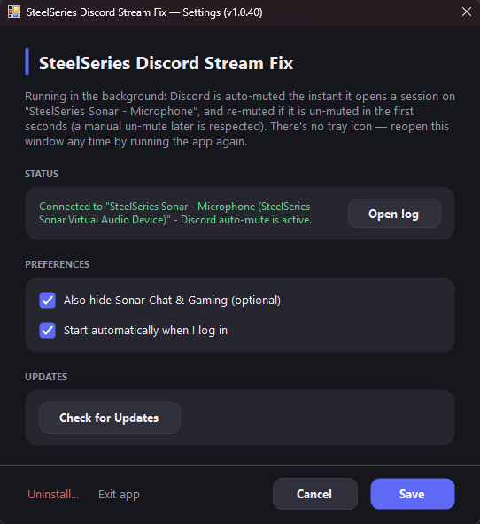

<div align="center">

# 🎧 SteelSeries Discord Stream Fix

### Keep Discord out of your SteelSeries Sonar virtual microphone.

A tiny Windows background app. Download one file, pick your options, press **Save**. Done.

[](../../releases/latest)

[](LICENSE)

<br>



</div>

---

## 😤 The problem

Sonar (part of SteelSeries GG) creates virtual audio devices in Windows: **Sonar - Gaming**, **Sonar - Chat** and **Sonar - Microphone**. Each app should go to its own channel so you can control every volume separately.

But Discord can open an audio session on **Sonar - Microphone** itself. Its audio then leaks into your virtual mic, which your stream or recording picks up, instead of staying in the Chat channel.

## ✅ The fix

| Problem | What the app does |
|---|---|
| Discord audio leaking into the virtual mic | Mutes Discord's session on **Sonar - Microphone** the moment it opens |
| Muting it by hand in the volume mixer, again and again | Fully automatic |
| Protection lost after restarting Sonar or Windows | Reconnects by itself |
| Cluttered device list | *Optional:* hide **Sonar - Chat** and **Sonar - Gaming** |
| Fear of leaving Windows in an odd state | On exit or shutdown it unmutes and restores only the devices **it** hid |

**Supported clients:** Discord (Stable, PTB, Canary, Development), Vesktop, Equibop, Legcord, ArmCord, WebCord and Dorion. Only these exact process names are muted. You can add more with [`ExtraProcessNames`](#-troubleshooting).

> ⚠️ Discord in a **web browser** is not supported, because it can't be told apart from other browser tabs.

---

## 🚀 Quick start

1. Make sure **SteelSeries GG** is installed and running.
2. Download **`SteelSeriesDiscordStreamFix-win-Setup.exe`** from the [latest release](../../releases/latest).
3. Open it, choose your options and press **Save**. Nothing is installed before that.

It installs for your Windows account only (**no admin rights**) and starts protecting Discord right away. There is no tray icon. To change settings later, open the same file again or launch the app from the Start menu.

Then just join a Discord call or start streaming. The settings window shows the Sonar connection status.

> 🛡️ The file isn't code-signed yet, so Windows SmartScreen may warn on first run. Click **More info → Run anyway**.

<details>
<summary><b>Already installed?</b></summary>

<br>

Opening a newer Setup file asks whether to update. Choose **No** and your installed version simply opens, with nothing changed.

</details>

---

## 🔄 Updates

The app checks for new versions in the background but **never installs one by itself**. When one is found, you get a normal Windows notification. Click it and choose:

- **Update now**
- **Skip this version** (no more notifications for it)
- **Later**

The settings window shows the same choices, and **Check for Updates** works at any time.

---

## 🙈 Hiding Sonar - Chat and Sonar - Gaming *(optional)*

You can hide these two devices from the Windows device list to reduce clutter.

It's optional because SteelSeries recommends keeping Discord's output on the Chat device, and hiding it may cut Discord audio for some people. **If Discord goes silent after enabling this, turn the option off.**

---

## 🛠️ Troubleshooting

<details>
<summary><b>Discord went silent after enabling "Hide Sonar - Chat / Gaming"</b></summary>

<br>

Turn that option off.

</details>

<details>
<summary><b>Status shows "Sonar not found"</b></summary>

<br>

Make sure Sonar is running. The app retries every 30 seconds.

</details>

<details>
<summary><b>Sonar Chat / Gaming stay hidden after a crash, a forced kill or deleting the app</b></summary>

<br>

Open **Sound settings → More sound settings → Playback**, right-click an empty area and tick **Show Disabled Devices**. Then right-click **SteelSeries Sonar - Chat** / **Gaming** and choose **Enable**.

</details>

<details>
<summary><b>Another Discord client (a fork) isn't muted</b></summary>

<br>

Add a string value `ExtraProcessNames` to `HKEY_CURRENT_USER\SOFTWARE\SteelSeriesDiscordStreamFix` with the process names separated by commas, for example `MyDiscordFork,AnotherClient`. Then restart the app.

</details>

<details>
<summary><b>Discord gets un-muted again by itself</b></summary>

<br>

After Discord opens a session, the app re-mutes it for 15 seconds, at most 3 times. If Discord restores its state later than that on your PC, set these DWORD values in `HKEY_CURRENT_USER\SOFTWARE\SteelSeriesDiscordStreamFix` and restart the app:

| Value | Range | Meaning |
|---|---|---|
| `RemuteWindowSeconds` | 5–120 | How long the app keeps re-muting |
| `MaxRemutes` | 1–10 | How many times it re-mutes |

The log says clearly when the app gives up on a session.

</details>

<details>
<summary><b>The app crashed</b></summary>

<br>

It restarts itself (at most 3 times in a row) and shows a notification. If it was closed abnormally (forced kill, power loss), the next start shows a notification too.

</details>

<details>
<summary><b>No warning notifications while gaming</b></summary>

<br>

Windows can hide notifications during Focus Assist / game mode. The current status is always visible in the settings window.

</details>

<details>
<summary><b>Something looks wrong</b></summary>

<br>

Open the log file from the settings window and attach it when you [report an issue](../../issues/new/choose). The log starts with the app version and Windows build, and your Windows user name is replaced by `%USERPROFILE%`, but please read it once before posting.

</details>

---

## ⚠️ Limitations

- Windows only, and **Sonar must be installed**.
- Discord in the browser is not supported.
- Hiding relies on an undocumented Windows API (`SetEndpointVisibility`) and may break after a Windows update.

---

## 👩‍💻 Development

```bash
# Build the app
dotnet build SteelSeriesDiscordStreamFix.csproj -c Release

# Run the unit tests
dotnet test Tests/SteelSeriesDiscordStreamFix.Tests.csproj
```

The tests cover the pure logic only: re-mute policy, hide-ownership rules, log redaction, Discord process matching and crash-restart limits. GitHub Actions builds both projects and runs the tests on every push and pull request.

---

## 📄 Disclaimer

This is an unofficial community tool and is **not affiliated with or endorsed by SteelSeries or Discord**. SteelSeries, Sonar and Discord are trademarks of their respective owners. Use at your own risk.

<div align="center">

**Found a bug or have an idea?** [Open an issue](../../issues/new/choose) · **Like it?** ⭐ the repo.

Released under the [MIT License](LICENSE).

</div>
