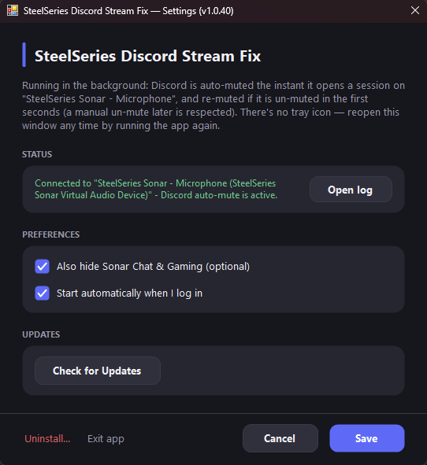

# SteelSeries Discord Stream Fix

A small Windows background utility that stops Discord audio from leaking into the **SteelSeries Sonar** virtual microphone, which is especially useful when streaming or recording.

Install it once, and it runs silently at Windows startup with no tray icon. To open the settings window, simply launch the app again.

## The Problem

Sonar (part of SteelSeries GG) creates virtual audio devices in Windows, such as **Sonar - Gaming**, **Sonar - Chat**, and **Sonar - Microphone**. The idea is to route each app to the right channel and control each channel's volume separately.

However, Discord can open an audio session on the **Sonar - Microphone** device itself. Its audio then ends up in the virtual microphone path instead of staying in the Chat channel.

### 1. Automatic Discord muting on the microphone device
The app monitors audio sessions on the **SteelSeries Sonar - Microphone** device. When Discord opens a session there, it is muted immediately.

### 2. Supported clients 
Discord (Stable), PTB, Canary, Development, and Vesktop.
Discord running in a web browser is **not supported**, since it cannot be distinguished from other browser tabs.

### 3. Hide Sonar - Chat and Sonar - Gaming (optional)
You can hide these two devices from the Windows device list to reduce clutter.

This is optional because SteelSeries recommends keeping Discord's output on the Chat device, and hiding it may cut Discord audio for some users. **If Discord goes silent after enabling this, turn the option off.**

## What It Solves

| Problem | How it's handled |
|---|---|
| Discord audio leaking into the virtual mic | Automatically mutes Discord's session on that device |
| Repeating manual setup | No need to open the volume mixer and mute Discord every time |
| Cluttered audio device list | Optional hide feature |
| Protection lost after restarting Sonar or Windows | Reconnects automatically |
| Worry about leaving the system in an odd state | On exit or Windows shutdown, the app unmutes and restores only the devices **it** hid |

## Installation

1. Make sure **SteelSeries GG** is installed and running.
2. Download the latest installer from the [Releases](../../releases) page.
3. Run it once. The app starts automatically with Windows and runs in the background.
4. To open settings, launch the app again.

## Usage

Once installed, there's nothing to do. Join a Discord call or start streaming, and Discord's session on **Sonar - Microphone** is muted automatically. Check the settings window to confirm the Sonar connection status.

## Troubleshooting

- **Discord went silent after enabling "Hide Sonar - Chat / Gaming":** turn that option off.
- **Status shows "Sonar not found":** make sure Sonar is running. The app retries every 30 seconds.
- **Something looks wrong:** open the log file from the settings window and attach it when reporting an issue.

## Disclaimer

This is an unofficial community tool and is **not affiliated with or endorsed by SteelSeries or Discord**. SteelSeries, Sonar, and Discord are trademarks of their respective owners. Use at your own risk.

## Limitations

- Windows only, and **Sonar must be installed**
- Discord in the browser is not supported
- Hiding relies on an undocumented Windows API (`SetEndpointVisibility`) and may break after a Windows update

## Summary

SteelSeries Discord Stream Fix does one job well: it keeps Discord audio out of Sonar's virtual microphone path without any effort on your part. With the latest changes, it shuts down more safely, produces fewer false alerts, avoids loops, and keeps the sensitive options optional and clearly explained.
